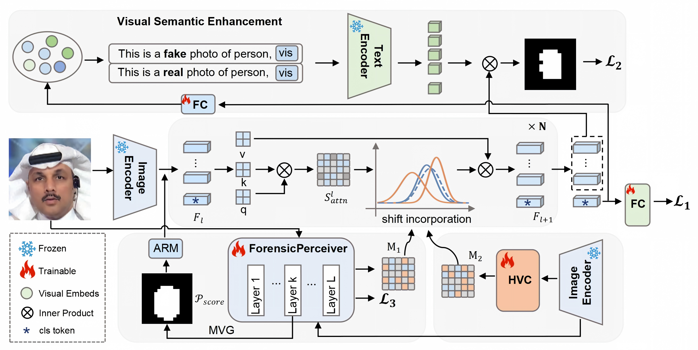

<div align="center">

<h1>Location-Guided Discriminative Learning for Face Forgery Detection</h1>

<div>
    Yunfei Li,
    <a href='https://homepage.hit.edu.cn/guopuzhu//' arget='_blank'>Guopu Zhu<sup>*</sup></a>,
  <a href='https://yuezunli.github.io//' target='_blank'>Yuezun Li</a>,
    Yicong Zhou, Hongli Zhang, Xingpeng Zhang
</div>
<div>
    Harbin Institute of Technology;
</div>


</div>

## 📢 Updates
- [11/2026] The test code is released.
- [11/2026] The train code will be available as soon as the paper is accepted.

## ⏳ Introduction
This is the official implementation of *Location-Guided Discriminative Learning for Face Forgery Detection*. In this paper ,we describe a Location-Guided Discriminative Learning Framework (LGD), which
integrates pretrained vision-language models (VLMs) with forgery location estimation for face forgery detection. Extensive experiments on multiple benchmark datasets demonstrate that LGD achieves superior performance compared with state-of-the-art methods under cross-dataset evaluation settings.


<div align="center">

</div>


## 🛠️ Installation


### Environment
Ensure your environment meets the following requirements:

- 🐍 Python 3.9
- 🔥 PyTorch 1.11
- 🚀 CUDA 11.3
  
Install dependencies:

```bash
git clone https://github.com/YunfeiLi-heng/LGD.git
cd LGD_Forgery
conda create -n LGD python=3.9
conda activate LGD
pip install -r requirements.txt
```

## 🏋️ Pretrained Models
We also provide the pretrained models.

| Model                                                                                                                                                      | Description
|:-----------------------------------------------------------------------------------------------------------------------------------------------------------| :----------
| [pretrained-model](https://stuouceducn-my.sharepoint.com/:u:/g/personal/liyunfei_x_stu_ouc_edu_cn/IQDkizgWQFj6T6yTWEPyr6bMAa2yOi6onEbCEcded35wkTA?e=ZjQaiM) | Trained on FF++ c23 set.

## 🧪 Testing
Please modify the relevant configurations in the test.yaml and test.py file before testing.

To test the model, you can directly load our pre-trained weights and run a command like the following:

```bash
python test.py 

